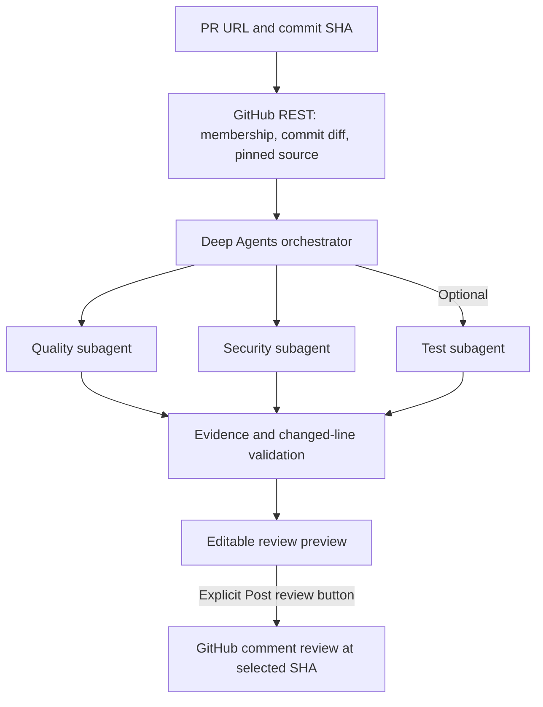

# PR Code Review Studio

A local Streamlit app that reviews **one commit in a GitHub pull request** with
a Deep Agents orchestrator and quality, security, and optional test subagents. Inspect
and edit the resulting review, then optionally post it to the existing PR.

See the [project documentation](docs/PROJECT_DOCUMENTATION.md) for architecture diagrams,
setup, configuration, workflow, and troubleshooting. The standalone diagram source is
[architecture.mmd](docs/architecture.mmd). A [Word version with embedded diagrams](docs/PROJECT_DOCUMENTATION.docx) is also available.

## Run

Requires Python 3.12 or newer:

```powershell
uv sync --group dev
Copy-Item .env.example .env
uv run streamlit run app.py
```

If you already have a private .env, keep it rather than copying over it.
Open http://localhost:8501.

## Review and post

1. Enter a URL such as https://github.com/owner/repo/pull/123.
2. Enter a full or unambiguous 7–40 character commit SHA from that PR, or leave
   it blank to review the latest PR commit.
3. Configure the model and API key in the sidebar and enable model-review consent.
   Enable **Include tests reviewer** when you want test coverage analysis; it is off by default.
4. Click **Start review**. The app verifies PR membership and compares the commit
   with its first parent. Root commits use the empty tree; merge commits use an
   explicit first-parent comparison.
5. Inspect findings, evidence, suggested fixes, and **Scope and limitations**.
6. In **Post review**, edit the text and inspect the rendered preview.
   Enter a GitHub token and click **Post review to PR** when ready.

Posting submits a GitHub review with event COMMENT and the exact reviewed
commit_id. This is a summary review with commit-specific source links. It does
not approve or request changes on the PR. Posting notifies PR participants.

Public PR reads can be anonymous. Private PRs require a GitHub token with read
access to repository contents and pull requests. Posting requires **Pull requests:
write** for the target repository. Enter the token in the sidebar or set
GITHUB_TOKEN in your private .env. Keep credentials out of source and reports.

Changing the PR URL or commit input clears the previous report and posting state.
Before posting, the app checks that the PR is open, its observed head has not
changed, and the selected commit still belongs to it. Historical PR commits are
supported. GitHub has no atomic compare-and-post operation; a concurrent update
can still race these checks.

A posting action makes at most one POST. After success or an uncertain failure,
the button is disabled for that review. A timed-out POST may have succeeded:
inspect GitHub before starting another review and posting again. Session state
does not provide durable deduplication across browser sessions or restarts.

## Model configuration

The app defaults to **Qwen3.5:4B running locally through Ollama**. The configured
model is `qwen3.5-review:4b`, a local alias built from the requested
`qwen3.5:4b`. It uses CPU inference and an 8K context window to avoid the GPU
device-loss crash previously observed on this computer. Local model analysis
requires no hosted API key or API credits. GitHub access/posting remains separate.

Prepare the model, then start the app:

```powershell
ollama pull qwen3.5:4b
ollama create qwen3.5-review:4b -f Modelfile.review
uv run streamlit run app.py
```

Set these values in your private .env, preserving existing credentials:

```dotenv
REVIEW_MODEL=qwen3.5-review:4b
REVIEW_QUALITY_MODEL=qwen3.5-review:4b
REVIEW_SECURITY_MODEL=qwen3.5-review:4b
REVIEW_TESTS_MODEL=qwen3.5-review:4b
OPENAI_BASE_URL=http://127.0.0.1:11434/v1
```

Click **Use local defaults** to restore the local endpoint and all four model
fields together. This leaves the tests-reviewer checkbox unchanged. Model
analysis runs on this computer. CPU reviews may take several minutes.

Quality and security reviews run by default. **Include tests reviewer** adds
test-coverage analysis when enabled and is initially unchecked. It suggests
tests without executing them. Disabled tests are excluded from model checks
and validation. Existing reports retain the roles/models used for that run.

The Qwen3.5 reviewers inspect evidence with read/search tools, then produce
a separate, tool-free JSON response using the compact local schema. Each
specialist reports at most one prioritized model finding; scanner findings
are retained. The model chooses a source-reference ID from an enumerated list.
The app fills its file, line, and exact quote from the immutable snapshot, then
validates evidence and changed-line scope. This prevents invented citation text
or line numbers from entering local findings. Inline patch
edits are omitted from normal local results. One correction attempt is
allowed for invalid local output within the same model-call budget.
Incomplete evidence gathering remains visible as an incomplete review.
The orchestrator and specialists share one model and serialize inference.

### Optional Groq setup

Click **Use Groq defaults** to select `https://api.groq.com/openai/v1` and
`openai/gpt-oss-120b` for every role, then enter a **Groq API key** in the
password field. Keys are used only for that browser session and are never
written to .env, reports, or activity. Hosted keys are not loaded from the
environment. Groq and OpenAI have separate password fields.

Groq specialists also separate evidence gathering from tool-free strict JSON.
Their compact schema permits up to three model findings. Shared Groq pacing,
request/token quotas, and bounded retries apply only to hosted Groq inference.
See [Groq model support](https://console.groq.com/docs/model/openai/gpt-oss-120b)
and [Groq rate limits](https://console.groq.com/docs/rate-limits).

### Optional OpenAI or other providers

Set the endpoint to `https://api.openai.com/v1` and use `gpt-5.4-mini` for
the orchestrator/tests plus `gpt-5.4` for quality/security. Enter an OpenAI
API key in its password field; API credits or active billing are required.
Other OpenAI-compatible providers remain configurable with supported model IDs.

**Check model access** is available for Groq and OpenAI. It checks credentials
and selected-model metadata without sending source or generating tokens; it
does not verify inference or quota. Groq compares exact IDs against its model
catalog. Restart after changing .env, and use the appropriate preset to replace
existing sidebar widget values.

## Scope and architecture

The UI is PR-only. Repository-wide, local-folder, demo, patch-approval, and
draft-PR-creation screens are no longer exposed. Legacy backend helpers remain
available to existing tests.



- The orchestrator can plan/delegate; specialists read/search a bounded immutable
  snapshot. System prompts are in reviewer/prompts.py.
- Ruff, Bandit, and supported dependency auditing supply static candidates.
  Scanner and model findings must quote evidence overlapping added/modified
  lines. Unchanged lines are supporting context.
- Only changed source files are collected. Unchanged tests/callers may be
  unavailable. Repository code and application tests are never executed.
- Deleted files, deletion-only/rename-only changes, binary/unsupported files,
  missing/truncated patches and budget omissions are reported as limitations and
  mark the report incomplete. A commit without supported added/modified text
  lines cannot be reviewed by this version.
- Limits: 60 files, 60 KB/file, 240 KB total, 40,000 diff characters. Root
  .gitignore and built-in exclusions apply; nested ignores are not interpreted.
  Filename-based secret exclusions do not guarantee source contains no secrets.
- PR commit listing is capped at 250. Larger PRs are rejected to avoid
  unverified membership. Commit-file listing caps at 3,000; merge comparisons at
  300 files. Coverage limits appear in the report.
- PR collection/posting uses GitHub REST with native system TLS verification.
  MCP settings remain for legacy helpers and are not required by this UI.
  Models have no GitHub publishing tools.

## Troubleshooting

Incomplete reports preserve available findings and show reviewer failures and
scope omissions. Authentication, provider rate limits, timeouts, structured
output errors, and agent call budgets can cause partial reviews. **Tool activity**
records safe failure messages without raw responses or credentials. Known provider
codes distinguish rejected tool calls (`tool_use_failed`) from rejected generated
JSON (`json_validate_failed`); other HTTP 400 errors remain unclassified.

For Groq, the app omits message-name metadata from outgoing requests because
Groq rejects `messages[].name`. Internal agent names, tool names, and tool-call
IDs are preserved. Offline regressions check multi-turn requests through the
real agent hierarchy against this restriction.

Groq GPT-OSS specialists gather evidence with automatic read/search tool use,
then make a separate tool-free strict JSON-schema request for the final review.
This avoids forcing the final review through a function call. The final schema
returns up to three concise findings; inline patch edits are omitted. Evidence,
paths, and changed-line scope remain validated. Evidence gathering is limited
to two tools and reserves the final call within the existing six-call budget.
A failed gathering phase can preserve validated final findings but marks the
review incomplete. Truncated inspection responses and shortened gathered evidence
also mark the review incomplete. Legacy revision calls retain the full patch schema.

Groq inference is paced across roles and browser sessions using the same API
key and model, with conservative limits of 8,000 estimated combined tokens and
30 requests per minute. Estimates include prompts, schemas, evidence history,
and reserved output tokens; observed usage updates reservations. Context and
source reads are smaller, and overlapping diff/excerpt context is removed.
Tool activity shows capacity waits, bounded to 65 seconds per request. SDK
retries are disabled; one explicit 429 retry is allowed only for a numeric
Retry-After of at most 60 seconds and consumes the same model-call budget.
Longer cooldowns and missing retry guidance fail without repeated requests.
Other keys/apps can consume the same organization quota, and daily/account
limits still apply. Metadata access checks do not verify inference quota.

For company proxy/VPN certificate failures, ask IT to install the approved CA in
the system trust store, or set SSL_CERT_FILE to an IT-provided PEM bundle and
restart. TLS verification stays enabled.

## Development

```powershell
uv run pytest
uv run ruff check .
```

Offline tests exercise real agent graphs using scripted models, commit
membership, diff parsing, evidence scope, source pinning, posting payloads and
stale-state checks, and the Streamlit preview/post flow. Tests do not call real
models or post real GitHub reviews.

Official API references: [PR commits](https://docs.github.com/en/rest/pulls/pulls#list-commits-on-a-pull-request),
[commit files](https://docs.github.com/en/rest/commits/commits#get-a-commit),
[first-parent comparison](https://docs.github.com/en/rest/commits/commits#compare-two-commits),
[create review](https://docs.github.com/en/rest/pulls/reviews#create-a-review-for-a-pull-request).
