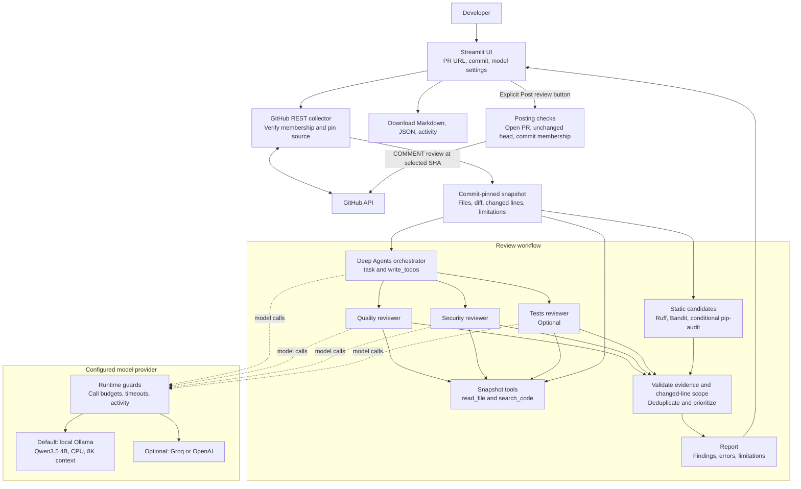
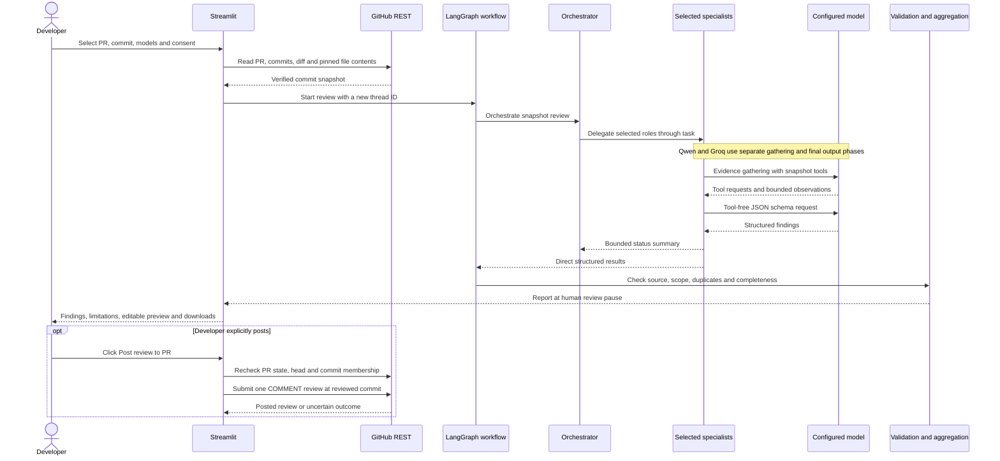

# PR Code Review Studio Project Documentation

PR Code Review Studio is a Streamlit application for reviewing one commit in an existing GitHub pull request. A Deep Agents orchestrator delegates analysis to quality and security reviewers, with an optional tests reviewer. Findings are checked against source from the selected commit before the developer inspects, edits, downloads, or posts the review.

This guide covers the current PR review UI, its internal architecture, local model setup, configuration, operating limits, and maintenance. The default model is Qwen3.5:4B through local Ollama. The application also retains Groq and OpenAI configurations.

## Contents

- [Architecture](#architecture)
- [Review workflow](#review-workflow)
- [Agents and model providers](#agents-and-model-providers)
- [Local setup](#local-setup)
- [Configuration](#configuration)
- [Data and validation](#data-and-validation)
- [GitHub publishing](#github-publishing)
- [Limits and incomplete reviews](#limits-and-incomplete-reviews)
- [Troubleshooting](#troubleshooting)
- [Code organization](#code-organization)
- [Development](#development)

## Architecture

The application runs as one Python Streamlit process with in-memory workflow and browser-session state. GitHub REST supplies commit data and accepts explicitly posted reviews. Ollama serves the default model locally on port 11434; hosted providers are optional alternatives.



The standalone diagram source is [architecture.mmd](architecture.mmd). GitHub and editors with Mermaid support can render the diagram in this guide.

The solid arrows show review data or control flow. Dotted arrows show model calls. Specialists use the same commit-pinned snapshot; they cannot browse arbitrary host files or publish to GitHub. The scanner layer runs installed analysis tools against temporary copies of included files.

### Component responsibilities

| Component | Responsibility |
| --- | --- |
| Streamlit UI | Collect inputs and credentials, show activity and findings, provide exports and an editable posting preview. |
| GitHub collector | Verify commit membership, compare against the first parent, fetch and verify pinned source, and record omissions. |
| LangGraph workflow | Invoke orchestration, aggregate validated results, and keep an in-memory checkpoint at the human review pause. |
| Deep Agents orchestrator | Plan and delegate once to each selected specialist using `task` and `write_todos`. |
| Specialists | Run applicable scanners, inspect bounded evidence with read/search tools, and return structured findings. |
| Runtime guards | Enforce tool and model call budgets, serialize local inference, pace Groq requests, and record safe activity. |
| Validation and reporting | Check citations and changed-line scope, merge duplicate findings, sort by severity, and create the report. |
| Posting service | Recheck the PR and submit the developer's edited text as a commit-specific GitHub comment review. |

The current UI reads the report when the graph pauses at `human_review`. It does not resume the legacy patch-approval flow. Posting from the UI calls a separate REST function.

## Review workflow

1. Enter an existing GitHub PR URL. Optionally enter a full SHA or an unambiguous 7 to 40 character prefix belonging to that PR. Leaving it blank selects the PR head.
2. Configure the endpoint and selected models. Quality and security are always selected; **Include tests reviewer** is initially unchecked.
3. Enable **Allow review using the configured model**, then click **Start review**.
4. The collector verifies PR membership and obtains the selected commit's diff against its first parent. Root commits use an empty-tree comparison. Merge commits use an explicit first-parent comparison.
5. Source files are retrieved at the selected SHA, checked against their Git blob hashes, filtered, and stored with added/modified line numbers in a snapshot. The collector checks that the PR head did not change during collection.
6. The orchestrator delegates to the selected specialists. Each role runs at most once per orchestration. Scanner findings and specialist results reach validation directly; the orchestrator receives bounded summaries.
7. Aggregation produces a report containing findings, reviewer results, and scope limitations. Available findings survive a specialist failure.
8. Inspect **Review findings**, **Scope and limitations**, and **Tool activity**. Download the report or edit the text in **Post review**.
9. To publish, provide a GitHub token and explicitly click **Post review to PR**.

Changing the PR URL or commit selection clears the prior report and posting state. Each saved report retains the roles and model IDs used for that run, even if the sidebar changes later.

### Qwen and Groq request sequence

The specialist calls below show the two-phase path for the configured Qwen and Groq models. Other provider configurations use the strategies described in the next section.



## Agents and model providers

| Agent | Purpose | Available model tools |
| --- | --- | --- |
| Orchestrator | Delegate selected review roles and summarize their outcomes. | `task`, `write_todos` |
| Quality | Find consequential correctness, edge-case, and error-handling defects. | `read_file`, `search_code` |
| Security | Trace untrusted inputs to unsafe operations and explain attack prerequisites. | `read_file`, `search_code` |
| Tests, optional | Identify missing boundary, failure, regression, and security test cases. | `read_file`, `search_code` |

The tests reviewer suggests tests; it does not execute the target application's tests or measure coverage. Disabling it removes that role from delegation, model-access checks, and expected report results, and records the omission.

### Configured models

These values describe the presets in [model_config.py](../reviewer/model_config.py). Hosted model availability and quota are determined by the selected provider and account.

| Configuration | Endpoint | Orchestrator | Quality and security | Tests when enabled |
| --- | --- | --- | --- | --- |
| Local default | `http://127.0.0.1:11434/v1` | `qwen3.5-review:4b` | `qwen3.5-review:4b` | `qwen3.5-review:4b` |
| Groq | `https://api.groq.com/openai/v1` | `openai/gpt-oss-120b` | `openai/gpt-oss-120b` | `openai/gpt-oss-120b` |
| OpenAI | `https://api.openai.com/v1` | `gpt-5.4-mini` | `gpt-5.4` | `gpt-5.4-mini` |

**Use local defaults** and **Use Groq defaults** update the endpoint and all four model fields together, preserving the tests checkbox. For OpenAI, enter its endpoint and role model IDs manually. Existing widget values may persist after changing environment settings.

### Structured review generation

For the configured Qwen model IDs and Groq GPT-OSS, each specialist uses two phases:

1. Gather evidence with automatic snapshot read/search tool calls.
2. Request the final review in a separate, tool-free JSON-schema response.

For normal Qwen reviews, the application builds a bounded set of references to actual source lines. The model chooses an enumerated `anchor_id`; application code supplies its file, line, and quote from the snapshot. Unknown IDs are rejected, and ordinary evidence and changed-line validation still apply. Each specialist may return at most one model finding. Scanner findings remain additional results.

Groq's compact final schema permits up to three model findings per specialist. Normal compact Qwen and Groq results omit inline patch edits. Other hosted configurations use LangChain's full review schema through `ToolStrategy`; other local model names use `ProviderStrategy` and do not automatically receive the Qwen anchor flow.

Exact source citations establish where evidence comes from. The developer must still assess whether a finding's reasoning and suggested fix are correct.

## Local setup

Install Python 3.12 or newer, uv, and Ollama. Run these commands from the project root in PowerShell:

```powershell
uv sync --group dev
if (-not (Test-Path .env)) { Copy-Item .env.example .env }

ollama pull qwen3.5:4b
ollama create qwen3.5-review:4b -f Modelfile.review

uv run streamlit run app.py --server.address 127.0.0.1
```

Ollama must be running. If its desktop application or background service is not running, start `ollama serve` in a separate terminal. Open [the app](http://localhost:8501), click **Use local defaults**, and enable model-review consent.

[Modelfile.review](../Modelfile.review) creates the alias from `qwen3.5:4b` with:

| Setting | Value | Purpose |
| --- | --- | --- |
| `num_ctx` | `8192` | Bound the context window. |
| `num_gpu` | `0` | Use CPU inference, avoiding the GPU device-loss failure observed during setup. |
| `temperature` | `0.2` | Set the alias's generation temperature. |

The application disables model thinking for local requests and serializes local inference. CPU reviews can take several minutes. Local model analysis requires no hosted model API key or per-token API credits. GitHub reads and optional dependency vulnerability lookups still require network access; posting requires a GitHub token.

## Configuration

The app loads `.env` at startup. Existing process environment variables take precedence under the default `load_dotenv()` behavior. Restart after editing `.env`, then apply the relevant sidebar preset to replace retained widget values.

| Setting | Meaning | Local default |
| --- | --- | --- |
| `OPENAI_BASE_URL` | OpenAI-compatible model endpoint, including `/v1`. | `http://127.0.0.1:11434/v1` |
| `REVIEW_MODEL` | Orchestrator model; also the shared local fallback. | `qwen3.5-review:4b` |
| `REVIEW_QUALITY_MODEL` | Quality role override. | `qwen3.5-review:4b` |
| `REVIEW_SECURITY_MODEL` | Security role override. | `qwen3.5-review:4b` |
| `REVIEW_TESTS_MODEL` | Tests role override, used only when selected in the UI. | `qwen3.5-review:4b` |
| `GITHUB_TOKEN` | Optional default for the GitHub password field. | Empty |
| `SSL_CERT_FILE` | Optional operator-provided CA bundle for environments that require it. | System trust configuration |

The UI accepts hosted model API keys through password fields for the current browser session. It does not load hosted model keys from environment variables or write them to `.env`, reports, or activity. Local Ollama uses the placeholder key `ollama`, and hosted key inputs are hidden for the local endpoint.

Public PRs can be read anonymously. Private PRs need a GitHub token with repository contents and pull-request read access. Posting needs **Pull requests: write** for the target repository.

**Check model access** is available for OpenAI and Groq. It inspects credentials and model metadata, without sending source or generating review tokens. A successful check does not verify inference, structured-output support, or remaining quota.

## Data and validation

The principal Pydantic models are defined in [models.py](../reviewer/models.py).

| Model | Contents and role |
| --- | --- |
| `Snapshot` | Reviewed SHA, first parent, observed PR head, source files, diff, changed-line map, and collection limitations. |
| `Finding` | Agent, title, severity, confidence, source location, evidence, impact, suggested fix, suggested tests, and optional edits. |
| `AgentResult` | One specialist's findings, limitations, and safe error message. |
| `Report` | Aggregated findings, reviewer results, limitations, revision, and completion status. |
| `ReviewBatch` | Structured full-schema response for model findings. |
| `LocalReviewBatch` | Compact local response converted into validated domain findings. |

A reportable finding must use a valid snapshot path and line range, quote source text from that range, and anchor its evidence on an added or modified line of the selected commit. Supporting unchanged code can appear in context. Supplied edits are checked for exact source matches, conflicts, and Python syntax before they can be displayed as a valid patch.

Aggregation merges findings only when path, start line, and normalized title match. It preserves sources and sorts results by severity, confidence, and location.

Review state, edited posting text, activity, and graph checkpoints are in memory; there is no database. Downloads are:

- `review.md`: rendered report with commit-specific source links.
- `review.json`: serialized `Report`.
- `tool-activity.json`: recorded activity events.

The editable posting body is separate from the Markdown report export. Editing that text does not change the validated findings or downloaded report.

### Static analysis and source handling

Quality runs Ruff's Python `F` diagnostics. Security runs Bandit for included Python files and conditionally runs pip-audit when the snapshot contains a `requirements.txt` made entirely of plain `name==version` pins. Dependency auditing does not install packages or resolve dependencies; vulnerability lookup can use the network.

Scanners operate on temporary copies with a restricted environment, `shell=False`, and a 90-second subprocess timeout. Repository application code and tests are not executed. Temporary scanner files are removed when their temporary-directory context exits.

Root `.gitignore` rules and built-in filename, directory, extension, and size exclusions filter collection. Nested ignore files are not interpreted. Filename exclusions cannot guarantee that included source is free of secrets. With a hosted model selected, included analysis content is sent to that provider after the developer enables consent.

## GitHub publishing

The review workflow has no GitHub write tools. Only the UI's explicit **Post review to PR** action calls [post_pr_review](../reviewer/pr_review.py).

Before posting, the app checks that the PR is open, the observed PR head is unchanged, and the reviewed commit still belongs to the PR. It then sends the edited body with `event: COMMENT` and `commit_id` set to the reviewed SHA. This creates a summary review with source links; it does not approve the PR or request changes.

Each click makes at most one POST, with no automatic POST retry. The session disables posting once an attempt begins, including uncertain failures. If a request times out, inspect GitHub before starting another review and posting again.

GitHub does not offer an atomic check-and-post operation, so a concurrent update can race the checks. Session memory does not provide durable duplicate protection across restarts or browser sessions.

## Limits and incomplete reviews

| Area | Current application limit |
| --- | --- |
| Collected source | 60 files; 60,000 UTF-8 bytes per file; 240,000 bytes total. |
| Diff context | 40,000 characters in the snapshot; model prompts use smaller excerpts. |
| PR membership | At most 250 commits; larger PRs are rejected. |
| Commit file listing | At most 3,000 files; reaching the cap marks coverage incomplete. |
| Merge comparison | A 300-file comparison marks coverage incomplete. |
| Orchestrator | Up to 8 model calls and 8 tool calls. |
| Two-phase specialists | Up to 6 model calls, including reserved final output, and 2 evidence tool calls. |
| Local reads | Up to 40 lines and 1,500 characters per `read_file` result. |
| Local source references | Up to 40 references within 2,600 serialized bytes. |
| Local generation | 2,048 output tokens; estimated combined request allowance of 7,500 tokens. |
| Local call timeout | 600 seconds per model call, not an overall review deadline. |
| Groq pacing | App safeguards of 8,000 estimated tokens and 30 requests per rolling minute per key/model, within this process. |
| Groq capacity waits | Up to 65 seconds per request; at most one explicit retry for numeric provider cooldowns of 60 seconds or less, within the call budget. |
| Posted review body | 1 to 60,000 characters. |

Local invalid structured output gets one correction attempt within the existing specialist budget. Groq token reservations include prompts, schemas, evidence, and output allowances; these estimates are not exact tokenizer counts or a statement of the account's provider quota.

Deleted files, deletion-only changes, rename-only changes, unsupported or binary files, missing patches, ignored changes, and collection-budget omissions limit coverage. A commit with no supported added/modified text lines is rejected. Only changed source files are collected, so unchanged tests, callers, and deployment context may be unavailable.

The report becomes incomplete when collection coverage is incomplete, selected reviewers fail or are missing, evidence gathering is reduced, or orchestration fails. Existing validated findings can still be useful. Disabling the optional tests reviewer is an explicit scope choice and does not itself mark the run incomplete.

A completed report means the selected workflow finished within its available scope. It does not establish full repository coverage, successful application tests, or absence of defects.

## Troubleshooting

| Symptom | What to check |
| --- | --- |
| Cannot connect to local model | Confirm Ollama is running and the endpoint is `http://127.0.0.1:11434/v1`. Run `ollama list` to confirm the alias exists. |
| Model unavailable | Match the model ID to the endpoint. Click the relevant preset; a Groq model ID and key cannot be used at an OpenAI endpoint. |
| Model access check passes but review fails | Inspect **Tool activity**. Metadata access does not exercise inference, tool calls, output schemas, or quota. |
| Invalid structured review or citation | Use the prepared Qwen alias or the configured supported provider path. A bounded correction can still fail; inspect limitations and reduce commit scope. |
| Groq 400 with `tool_use_failed` | The provider rejected a tool call. Evidence gathering may be reduced; inspect the affected reviewer result. |
| Groq 429 or `model.rate_limit` waiting | Roles share capacity. Avoid overlapping runs and inspect provider quota. Waits and retries are bounded. |
| Local review takes minutes | CPU inference is serialized. Keep the tests reviewer off unless needed and use a smaller commit. |
| No supported changed lines | The commit may contain only deletions, renames, unsupported files, or unavailable/oversized patches. Choose a commit with supported added/modified text. |
| HTTPS certificate error | Use the system's approved CA trust or an operator-provided `SSL_CERT_FILE`, then restart. TLS verification stays enabled. |
| Posting outcome uncertain | Inspect the PR on GitHub before another posting attempt; the first request may have succeeded. |

Activity records include agent, tool, status, timing, and safe summaries. Raw provider payloads and credentials are excluded. The activity shown after a failure is the primary in-app diagnostic record.

## Code organization

| File | Responsibility |
| --- | --- |
| [app.py](../app.py) | Streamlit inputs, presets, consent, background execution, session state, exports, and explicit posting. |
| [pr_review.py](../reviewer/pr_review.py) | Current PR REST collection, pinned content verification, membership checks, and comment-review posting. |
| [models.py](../reviewer/models.py) | Snapshot, findings, reviewer results, report, and legacy decision models. |
| [workflow.py](../reviewer/workflow.py) | LangGraph orchestration, aggregation, in-memory checkpoint, and legacy patch preparation. |
| [agents.py](../reviewer/agents.py) | Model clients, selected roles, Deep Agents supervisor, specialist construction, and model-access checks. |
| [prompts.py](../reviewer/prompts.py) | Role instructions and treatment of repository content as untrusted data. |
| [structured_review.py](../reviewer/structured_review.py) | Separate evidence gathering and native structured final responses for configured Qwen/Groq paths. |
| [local_anchors.py](../reviewer/local_anchors.py) | Snapshot-derived reference list, enum schema, and conversion to exact source citations. |
| [local_review.py](../reviewer/local_review.py) | Compact local schema and evidence validation. |
| [agent_runtime.py](../reviewer/agent_runtime.py) | Tool restrictions, call/context budgets, local inference lock, and model activity. |
| [provider_limits.py](../reviewer/provider_limits.py) | Shared Groq reservations, cooldowns, token estimates, and observed-usage updates. |
| [scanners.py](../reviewer/scanners.py) | Ruff, Bandit, conditional dependency audits, and Python syntax validation. |
| [commit_scope.py](../reviewer/commit_scope.py) | Diff parsing and added/modified-line evidence checks. |
| [sources.py](../reviewer/sources.py) | Eligibility rules, source budgets, and legacy snapshot helpers. |
| [fixes.py](../reviewer/fixes.py) | Exact edit validation and unified diffs used by the current UI and legacy patch helpers. |
| [reporting.py](../reviewer/reporting.py) | Markdown report generation. |
| [activity.py](../reviewer/activity.py), [diagnostics.py](../reviewer/diagnostics.py) | Thread-safe activity and safe error classification. |
| [Modelfile.review](../Modelfile.review) | CPU-based Qwen alias and 8K context configuration. |
| [pyproject.toml](../pyproject.toml), [uv.lock](../uv.lock) | Python dependencies and locked environment. |
| [tests](../tests) | Offline regressions for agents, providers, PR scope, publishing, and the UI. |

The `github.py`, `public_github.py`, and `publishing.py` modules retain library helpers for older repository/MCP collection and patch/draft-PR workflows. The current PR-only UI does not expose local-folder review, repository-wide review, patch approval, or draft-PR creation. MCP server settings are not required for the current UI.

## Development

Run offline checks from the project root:

```powershell
uv run pytest -q
uv run ruff check .
```

The tests use scripted models and HTTP fixtures to exercise real agent graphs, provider request formats, local source references, optional role selection, diff scope, GitHub posting payloads, stale-state checks, and Streamlit flows. They do not call live models or post real reviews.

A manual smoke check is to start Ollama and the app, apply local defaults, review a small PR commit, confirm source links point to the reviewed SHA, inspect limitations, and download the report. A live provider check can exercise generation without posting; publishing remains a separate explicit action.

When changing provider integration, preserve the separation between model tools and GitHub publishing, keep source/evidence validation after generation, and ensure partial failures retain findings with clear limitations. When changing the UI, preserve the roles and model configuration stored with each completed run.
